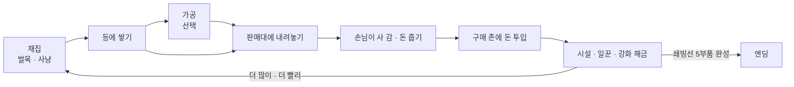

# 얼음 위의 작은 상점 (가칭 Frost Camp) 기획서

## 1. 한 줄 컨셉

혹한의 섬에 떨어진 생존자가 북극곰을 잡고 나무를 베어 손님에게 팔고, 번 돈으로 일꾼과 기계를 들여 캠프를 자동화한 뒤, 쇄빙선을 완성해 섬을 탈출하는 3D 아케이드 아이들 게임.

## 2. 핵심 재미 가설

출발점은 화이트아웃 서바이벌 광고 속 미니게임이었다. 사냥하고, 베고, 팔고, 그 돈으로 기지를 키우는 흐름이 짧은 영상만 봐도 손이 간다. 이 공식을 하이퍼캐주얼 "아케이드 아이들" 장르의 문법으로 정리하고, 추위라는 압박을 하나 더한다.

- **손에 쌓이는 쾌감.** 자원을 주우면 캐릭터 등 뒤로 탑처럼 쌓이고, 판매대에 서면 촤르륵 빠지면서 돈이 튀어나온다. 숫자보다 눈에 보이는 물건으로 성장을 느낀다.
- **내 손에서 시스템으로.** 처음엔 내가 다 한다. 일꾼이나 컨베이어를 살 때마다 내가 하던 일이 하나씩 사라진다. "이제 이건 안 해도 된다"는 해방감이 이 장르의 핵심 보상이다.
- **차별점: 추위 게이지.** 밖에 오래 있으면 몸이 얼어 느려진다. 모닥불과 난로 근처에서 회복한다. 북극곰 구역은 멀고 추워서 "지금 사냥 갈까, 판매부터 할까"를 잠깐 고민하게 된다. 일꾼에게도 같은 규칙이 적용되므로 난로를 어디 두느냐가 곧 자동화 설계가 된다.

## 3. 코어 루프

- **조작은 이동 하나뿐이다.** 키보드는 WASD, 웹·모바일은 가상 조이스틱. 채집, 판매, 구매는 그 자리에 서 있으면 자동으로 일어난다.
- **구매 존.** 바닥에 가격이 적힌 원판이 있다. 위에 서 있으면 돈이 빨려 들어가며 게이지가 차고, 다 차면 시설이 튀어나오듯 생긴다.

## 4. 시스템 요약

수치(가격, 체력, 리스폰 시간, 해금 비용)는 모두 `frost_camp/data/balance.json`에 둔다. 이 문서에는 구조만 적는다.

| 시스템 | 내용 |
|---|---|
| 자원 | 원목, 곰 고기, 곰 가죽. 가공품은 장작, 구운 고기, 털옷. |
| 채집 | 나무는 근처에 서면 도끼질을 하고, 정해진 타수가 차면 쓰러져 원목을 떨군 뒤 시간이 지나면 다시 자란다. 북극곰은 배회하다가 가까이 가면 싸움이 붙는다(자동 공격). 곰도 반격하므로 체력이 있다. 쓰러지면 고기와 가죽을 떨구고 다시 나타난다. |
| 운반 | 등 뒤 스택. 최대 적재량은 배낭 강화로 늘어난다. |
| 가공 | 장작 패는 곳, 고기 굽는 화로, 재봉대. 원재료를 넣으면 시간이 지나 가공품이 나오고, 가공품은 비싸게 팔린다. |
| 판매 | 품목별 판매대에 손님 NPC가 줄을 선다. 손님에게는 인내심이 있어서 재고가 없으면 화내고 떠난다. |
| 업그레이드 | 이동 속도, 적재량, 도끼·작살 공격력, 추위 저항. |
| 자동화 | 벌목꾼, 사냥꾼, 운반꾼(채집 지점에서 판매대로), 계산원(판매대의 돈 수거), 컨베이어·썰매 레일, 일꾼 속도·적재 강화. |
| 추위 | 플레이어와 일꾼이 같은 게이지를 쓴다. 0이 되면 이동 속도가 절반이 된다. 죽지는 않는다. 모닥불 → 난로 → 온실 순으로 따뜻한 범위가 넓어진다. |
| 지역 해금 | 캠프 → 숲 → 곰 서식지 → 빙하 계곡(희귀 자원 빙결정) → 항구. 지역을 사면 얼음벽이 녹으며 길이 열린다. |

## 5. 진행 흐름과 엔딩

한 판은 약 30분이다. 웹 포트폴리오로 공개했을 때 끝까지 볼 수 있는 길이로 잡았다.

| 단계 | 목표 시간 | 플레이어가 하는 일 | 해금 |
|---|---|---|---|
| 1. 표류 | 0~3분 | 직접 벌목하고 판다 | 원목 판매대, 배낭 |
| 2. 사냥 | 3~8분 | 곰을 잡아 고기를 판다 | 고기 판매대, 화로, 첫 벌목꾼 |
| 3. 자동화 | 8~15분 | 일꾼·운반꾼을 고용하고 가공품을 판다 | 계산원, 재봉대, 난로 |
| 4. 확장 | 15~25분 | 빙하 계곡을 열고 빙결정을 캔다 | 컨베이어, 항구 |
| 5. 탈출 | 25~30분 | 항구에서 쇄빙선 부품 5개를 사서 조립한다 | 엔딩 |

**엔딩:** 쇄빙선 부품 5개(선체, 엔진, 쇄빙날, 돛대, 연료)를 모두 사서 배를 완성하면 탈출 컷신이 나온다. 이어서 결과 화면에 총 플레이 시간, 번 돈, 잡은 곰 수, 고용한 일꾼 수를 보여 준다. 엔딩 후에는 같은 맵에서 더 빠른 기록에 도전할 수 있다(타임어택). 무한 플레이는 넣지 않는다.

## 6. 참고한 게임

장르 공식만 빌리고, 이름·캐릭터·아트·고유 설정은 가져오지 않는다.

| 게임 | 가져온 것 |
|---|---|
| Pizza Ready!, Burger Please!, My Perfect Hotel | 등 뒤 스택, 바닥 구매 존, 손님 줄, 계산원 고용으로 이어지는 단계적 자동화 |
| 화이트아웃 서바이벌 광고 미니게임 | 혹한 테마와 사냥·벌목 → 판매 루프라는 출발 아이디어 |
| Frostpunk | 추위를 자원 관리의 압박으로 쓰는 감각. 규모는 캐주얼하게 줄였다. |

## 7. 기술과 빌드

- **엔진:** Godot 4.7 표준(GDScript) 빌드, 렌더러 `gl_compatibility`. 웹(HTML5) 익스포트가 우선이고 Windows 빌드를 함께 낸다.
- **카메라:** 고정 쿼터뷰(45°) Camera3D가 플레이어를 부드럽게 따라간다. 웹 성능을 위해 그림자는 방향광 하나만 쓴다.
- **이동과 길찾기:** 플레이어는 CharacterBody3D, 일꾼·손님·곰은 CharacterBody3D + NavigationAgent3D. 충돌체는 캡슐과 박스만 쓴다.
- **폴더 구조:** 기존 프로젝트 규칙을 그대로 따른다.

| 경로 | 내용 |
|---|---|
| `frost_camp/sim/` | 경제, 인벤토리, 채집, 추위 규칙. 노드에 의존하지 않는 순수 GDScript라서 게임과 봇이 같은 규칙을 쓴다. |
| `frost_camp/data/balance.json` | 모든 수치 |
| `frost_camp/scenes/`, `frost_camp/ui/` | 화면과 연출 |
| `playtest/` | 봇 결과: 엔딩까지 걸린 시간, 단계별 돈 곡선, 막히는 구간 |

- **봇:** "가장 싼 다음 해금을 사는" 탐욕 봇으로 엔딩까지 돌린다. 5장 표의 단계별 목표 시간과 실제 곡선을 비교해 해금 비용을 조정한다. 재미는 사람이 판단한다.
- **손맛:** 돈이 튀어나오는 트윈, 걸을 때 흔들리는 스택, 나무가 쓰러질 때 히트스톱과 화면 흔들림, 구매 존이 다 찼을 때 팝 스케일.

## 8. 에셋

무료이고 상업적으로 쓸 수 있는 CC0 에셋 위주로 고른다. 내려받을 때 라이선스를 다시 확인하고, 출처는 `frost_camp/CREDITS.md`에 적는다.

| 용도 | 추천 |
|---|---|
| 캐릭터(플레이어·일꾼·손님) | KayKit Adventurers, Kenney Mini Characters (리깅·애니메이션 포함) |
| 북극곰 | Quaternius 동물 팩의 곰 모델에 흰색 머티리얼 적용 |
| 나무·바위·지형 | KayKit Forest Nature Pack, Kenney Nature Kit. 윗면을 하얗게 칠하는 눈 셰이더를 덧씌운다. |
| 건물·가구·판매대 | Kenney Survival Kit, Kenney Furniture Kit, KayKit Medieval Builder |
| 배·항구 | Kenney Pirate Kit |
| UI | Kenney UI Pack. 한글 폰트는 Google Fonts의 Jua 또는 Do Hyeon. |
| 효과음·음악 | Kenney Audio(RPG, Impact Sounds), 음악은 OpenGameArt의 CC0 곡 |
| 눈 내리는 효과 | 직접 만든 파티클. 웹 호환을 위해 CPUParticles3D로 대체할 수 있게 둔다. |

## 9. MVP 범위

포트폴리오 마감(2026-11-24)에 맞춰 7~9일 분량으로 자른다.

1. 이동 · 스택 · 판매 루프 (나무 1종)
2. 구매 존과 업그레이드
3. 곰 사냥
4. 일꾼 3종 자동화 (벌목꾼, 운반꾼, 계산원)
5. 추위 게이지
6. 쇄빙선 엔딩
7. 봇으로 밸런스 측정
8. 웹 빌드와 손맛 다듬기

시간이 남으면 넣는 것: 가공품 2종(구운 고기, 털옷), 빙하 계곡, 타임어택.
