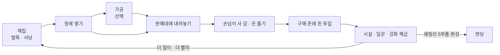

# 얼음 위의 작은 상점 (가칭 Frost Camp) 기획서

## 1. 한 줄 컨셉

혹한의 섬에 떨어진 생존자가 북극곰을 잡고 나무를 베어 손님에게 팔고, 번 돈으로 일꾼과 기계를 들여 캠프를 자동화한 뒤, 쇄빙선을 완성해 섬을 탈출하는 3D 아케이드 아이들 게임.

## 2. 핵심 재미 가설

출발점은 화이트아웃 서바이벌 광고 속 미니게임이었다. 사냥하고, 베고, 팔고, 그 돈으로 기지를 키우는 흐름이 짧은 영상만 봐도 손이 간다. 이 공식을 하이퍼캐주얼 "아케이드 아이들" 장르의 문법으로 정리하고, 추위라는 압박을 하나 더한다.

- **손에 쌓이는 쾌감.** 자원을 주우면 캐릭터 등 뒤로 탑처럼 쌓이고, 판매대에 서면 촤르륵 빠지면서 돈이 튀어나온다. 숫자보다 눈에 보이는 물건으로 성장을 느낀다.
- **내 손에서 시스템으로.** 처음엔 내가 다 한다. 일꾼이나 컨베이어를 살 때마다 내가 하던 일이 하나씩 사라진다. "이제 이건 안 해도 된다"는 해방감이 이 장르의 핵심 보상이다.
- **차별점: 추위 게이지.** 밖에 오래 있으면 몸이 얼어 느려진다. 모닥불과 난로 근처에서 회복한다. 북극곰 구역은 멀고 추워서 "지금 사냥 갈까, 판매부터 할까"를 잠깐 고민하게 된다. 일꾼에게도 같은 규칙이 적용되므로 난로를 어디 두느냐가 곧 자동화 설계가 된다.

## 3. 코어 루프

- **조작은 이동 하나뿐이다.** 키보드는 WASD, 웹·모바일은 가상 조이스틱. 채집, 판매, 구매는 그 자리에 서 있으면 자동으로 일어난다.
- **구매 존.** 바닥에 가격이 적힌 원판이 있다. 위에 서 있으면 돈이 빨려 들어가며 게이지가 차고, 다 차면 시설이 튀어나오듯 생긴다.

## 4. 시스템 요약

수치(가격, 체력, 리스폰 시간, 해금 비용)는 모두 `frost_camp/data/balance.json`에 둔다. 이 문서에는 구조만 적는다.

| 시스템 | 내용 |
|---|---|
| 자원 | 원목, 곰 고기, 곰 가죽. 가공품은 장작, 구운 고기, 털옷. |
| 채집 | 나무는 근처에 서면 도끼질을 하고, 정해진 타수가 차면 쓰러져 원목을 떨군 뒤 시간이 지나면 다시 자란다. 북극곰은 배회하다가 가까이 가면 싸움이 붙는다(자동 공격). 곰도 반격하므로 체력이 있다. 쓰러지면 고기와 가죽을 떨구고 다시 나타난다. |
| 운반 | 등 뒤 스택. 최대 적재량은 배낭 강화로 늘어난다. |
| 가공 | 장작 패는 곳, 고기 굽는 화로, 재봉대. 원재료를 넣으면 시간이 지나 가공품이 나오고, 가공품은 비싸게 팔린다. |
| 판매 | 품목별 판매대에 손님 NPC가 줄을 선다. 손님은 떠나지 않고, 한 명이 사 가면 바로 다음 손님이 와서 줄은 늘 가득 차 있다(1차 QA에서 바꿈). |
| 업그레이드 | 이동 속도, 적재량, 도끼·작살 공격력, 추위 저항. |
| 자동화 | 벌목꾼, 사냥꾼, 운반꾼(채집 지점에서 판매대로), 계산원(판매대의 돈 수거), 컨베이어·썰매 레일, 일꾼 속도·적재 강화. |
| 추위 | 플레이어와 일꾼이 같은 게이지를 쓴다. 0이 되면 이동 속도가 절반이 된다. 죽지는 않는다. 모닥불 → 난로 → 온실 순으로 따뜻한 범위가 넓어진다. |
| 지역 해금 | 캠프 → 숲 → 곰 서식지 → 빙하 계곡(희귀 자원 빙결정) → 항구. 지역을 사면 얼음벽이 녹으며 길이 열린다. |
| 습격과 방어 | 서식지를 연 뒤 북극곰 무리가 주기적으로 기지를 습격해 적치장·컨베이어·포탑을 부순다. 플레이어가 근접 전투로 막고, 돈으로 산 작살 포탑이 돕는다. 부서진 시설은 수리 존에 돈을 내야 다시 작동한다(1차 QA에서 추가). |
| 기지 확장 | 울타리로 둘러싼 확장 땅을 사면 울타리가 꺼지며 기지가 넓어지고, 새 숲·판매대·포탑 자리가 생긴다(1차 QA에서 추가). |

## 5. 진행 흐름과 엔딩

한 판은 약 30분이다. 웹 포트폴리오로 공개했을 때 끝까지 볼 수 있는 길이로 잡았다.

| 단계 | 목표 시간 | 플레이어가 하는 일 | 해금 |
|---|---|---|---|
| 1. 표류 | 0~3분 | 직접 벌목하고 판다 | 원목 판매대, 배낭 |
| 2. 사냥 | 3~8분 | 곰을 잡아 고기를 판다 | 고기 판매대, 화로, 첫 벌목꾼 |
| 3. 자동화 | 8~15분 | 일꾼·운반꾼을 고용하고 가공품을 판다 | 계산원, 재봉대, 난로 |
| 4. 확장 | 15~25분 | 빙하 계곡을 열고 빙결정을 캔다 | 컨베이어, 항구 |
| 5. 탈출 | 25~30분 | 항구에서 쇄빙선 부품 5개를 사서 조립한다 | 엔딩 |

**엔딩:** 쇄빙선 부품 5개(선체, 엔진, 쇄빙날, 돛대, 연료)를 모두 사서 배를 완성하면 탈출 컷신이 나온다. 이어서 결과 화면에 총 플레이 시간, 번 돈, 잡은 곰 수, 고용한 일꾼 수를 보여 준다. 엔딩 후에는 같은 맵에서 더 빠른 기록에 도전할 수 있다(타임어택). 무한 플레이는 넣지 않는다.

## 6. 참고한 게임

장르 공식만 빌리고, 이름·캐릭터·아트·고유 설정은 가져오지 않는다.

| 게임 | 가져온 것 |
|---|---|
| Pizza Ready!, Burger Please!, My Perfect Hotel | 등 뒤 스택, 바닥 구매 존, 손님 줄, 계산원 고용으로 이어지는 단계적 자동화 |
| 화이트아웃 서바이벌 광고 미니게임 | 혹한 테마와 사냥·벌목 → 판매 루프라는 출발 아이디어 |
| Frostpunk | 추위를 자원 관리의 압박으로 쓰는 감각. 규모는 캐주얼하게 줄였다. |

## 7. 기술과 빌드

- **엔진:** Godot 4.7 표준(GDScript) 빌드, 렌더러 `gl_compatibility`. 웹(HTML5) 익스포트가 우선이고 Windows 빌드를 함께 낸다.
- **카메라:** 고정 쿼터뷰(45°) Camera3D가 플레이어를 부드럽게 따라간다. 웹 성능을 위해 그림자는 방향광 하나만 쓴다.
- **이동과 길찾기:** 플레이어는 CharacterBody3D, 일꾼·손님·곰은 CharacterBody3D + NavigationAgent3D. 충돌체는 캡슐과 박스만 쓴다.
- **폴더 구조:** 기존 프로젝트 규칙을 그대로 따른다.

| 경로 | 내용 |
|---|---|
| `frost_camp/sim/` | 경제, 인벤토리, 채집, 추위 규칙. 노드에 의존하지 않는 순수 GDScript라서 게임과 봇이 같은 규칙을 쓴다. |
| `frost_camp/data/balance.json` | 모든 수치 |
| `frost_camp/scenes/`, `frost_camp/ui/` | 화면과 연출 |
| `playtest/` | 봇 결과: 엔딩까지 걸린 시간, 단계별 돈 곡선, 막히는 구간 |

- **봇:** "가장 싼 다음 해금을 사는" 탐욕 봇으로 엔딩까지 돌린다. 5장 표의 단계별 목표 시간과 실제 곡선을 비교해 해금 비용을 조정한다. 재미는 사람이 판단한다.
- **손맛:** 돈이 튀어나오는 트윈, 걸을 때 흔들리는 스택, 나무가 쓰러질 때 히트스톱과 화면 흔들림, 구매 존이 다 찼을 때 팝 스케일.

## 8. 에셋

무료이고 상업적으로 쓸 수 있는 CC0 에셋 위주로 고른다. 내려받을 때 라이선스를 다시 확인하고, 출처는 `frost_camp/CREDITS.md`에 적는다.

| 용도 | 추천 |
|---|---|
| 캐릭터(플레이어·일꾼·손님) | KayKit Adventurers, Kenney Mini Characters (리깅·애니메이션 포함) |
| 북극곰 | Quaternius 동물 팩의 곰 모델에 흰색 머티리얼 적용 |
| 나무·바위·지형 | KayKit Forest Nature Pack, Kenney Nature Kit. 윗면을 하얗게 칠하는 눈 셰이더를 덧씌운다. |
| 건물·가구·판매대 | Kenney Survival Kit, Kenney Furniture Kit, KayKit Medieval Builder |
| 배·항구 | Kenney Pirate Kit |
| UI | Kenney UI Pack. 한글 폰트는 Google Fonts의 Jua 또는 Do Hyeon. |
| 효과음·음악 | Kenney Audio(RPG, Impact Sounds), 음악은 OpenGameArt의 CC0 곡 |
| 눈 내리는 효과 | 직접 만든 파티클. 웹 호환을 위해 CPUParticles3D로 대체할 수 있게 둔다. |

## 9. MVP 범위

포트폴리오 마감(2026-11-24)에 맞춰 7~9일 분량으로 자른다.

1. 이동 · 스택 · 판매 루프 (나무 1종)
2. 구매 존과 업그레이드
3. 곰 사냥
4. 일꾼 3종 자동화 (벌목꾼, 운반꾼, 계산원)
5. 추위 게이지
6. 쇄빙선 엔딩
7. 봇으로 밸런스 측정
8. 웹 빌드와 손맛 다듬기

시간이 남으면 넣는 것: 가공품 2종(구운 고기, 털옷), 빙하 계곡, 타임어택.

## 10. 1차 사람 QA 이후 바뀐 점 (2026-11-12)

MVP를 직접 해 본 뒤 나온 7가지를 반영했다. 봇 결과와 이유는 `playtest/2026-11-12_qa1_step1_note.md`와 `playtest/2026-11-12_qa1_balance_log.md`에 있다.

| QA에서 나온 것 | 바꾼 것 |
|---|---|
| 손님 줄이 비면 템포가 느려진다 | 손님은 떠나지 않고 줄은 늘 가득 찬다. |
| 벌목꾼이 쌓은 원목을 가져갈 수 없다 | 플레이어도 적치장에 서면 원목을 집는다. |
| 기지를 지키는 재미가 있어야 한다 | 습격 웨이브, 시설 체력과 체력바, 돈 내고 수리, 작살 포탑 3곳, 운반꾼 다음 단계인 컨베이어 벨트. |
| 기지를 넓힐 수 있어야 한다 | 확장 땅 2곳(남쪽 숲, 남동쪽 장터). |
| 타격감이 없다 | 파편, 데미지 숫자, 휘청임, 화면 흔들림, 짧은 히트스톱. |
| 사운드가 없다 | Kenney 효과음과 짧은 음악(경고, 고용, 탈출). 배경음은 아직 없다. |
| 베는 동작이 없고 나무가 적다 | 주먹 → 도끼 휘두르기 동작, 나무 5그루 → 33그루(확장 땅에 12그루 더). |

규칙을 정하면서 생긴 결정:
- 판매대는 습격 대상이 아니다. 판매대가 부서지면 돈을 못 벌어 수리비도 못 내는 막다른 상황이 생겼다.
- 습격 곰은 고기 대신 현상금을 준다. 고기 판매대가 열리기 전에 고기가 등에 쌓여 아무것도 못 하는 상황이 생겼다.
- 노릴 시설이 없는 습격 곰은 플레이어에게 달려든다.

## 11. 2차 사람 QA 이후 바뀐 점 (2026-11-12)

사람 QA 원문, 해석, 재미 판단은 `playtest/human_qa_log.md`에 회차별로 모은다. 밸런스는 `playtest/2026-11-12_qa2_balance_log.md`에 있다.

| QA에서 나온 것 | 바꾼 것 |
|---|---|
| 계산대마다 직원을 고용하고 싶다 | 판매대별 전담 계산원 3명(원목, 고기, 장터) |
| 곰을 잡는 사람을 고용하고 싶다 | 사냥꾼(2명까지)과 서식지 앞 고기 적치장. 운반꾼은 두 적치장 중 많이 쌓인 쪽을 나른다. |
| 포탑 말고 울타리를 두고 크게 하고 싶다 | 기지 둘레 방벽(3단계). 습격 곰은 방벽 구간부터 부숴야 들어오고, 확장하면 방벽이 바깥으로 옮겨진다. |
| 그럴듯한 탈출 컷신 | 영화 띠, 승선, 뱃고동, 얼음을 밀어내며 출항, 제목, 결과 화면 |
| 곰을 더 나오게 하는 걸 팔면? | 곰 늘리기(2단계, 서식지 곰 3 → 7마리) |
| 기지를 부수는 곰도 고기를 | 고기 판매대가 열린 뒤 직접 잡으면 고기 2개, 그 전이나 포탑이 잡으면 현상금 |
| 계산하고 나가는 모습이 어색하다 | 손님이 물건을 들고 걸어 나가고, 줄이 걸어서 당겨지고, 새 손님이 걸어 들어온다. |

기지 방벽 때문에 남동쪽 장터를 방벽 선에 맞춰 3m 남쪽으로 옮기고, 습격 곰 스폰 지점을 방벽 밖으로 뺐다.

## 12. 3차 사람 QA 이후 바뀐 점 (2026-11-13)

사람 QA 원문과 재미 판단은 `playtest/human_qa_log.md`, 밸런스는 `playtest/2026-11-13_qa3_balance_log.md`에 있다.

| QA에서 나온 것 | 바꾼 것 |
|---|---|
| 방벽을 업그레이드하면 모양도 바뀌었으면 | 나무 울타리 → 돌담 → 철벽 |
| 장터까지 가는 동선이 이상하다 | 남쪽 두 확장 땅을 붙여 기지 남쪽을 한 덩어리로 |
| 곰보다 먼저 낚시, 곰은 나중에 비싸게 | 캠프 옆 얼음 구멍 낚시, 연어 판매대·낚시꾼. 곰 서식지는 연어 판매대 뒤로, 고기 $22 |
| 두 번째 숲은 더 비싼 것을 | 남쪽 땅을 빙결정 광맥으로(곡괭이, 광부, 빙결정 $30) |
| 일꾼이 계속 언다 | 일꾼은 추위를 타지 않는다 |
| 난로 원이 따로 겹친다 | 난로를 없애고 모닥불 하나를 키운다(반경 4 → 12) |
| 운반꾼과 컨베이어가 같이 있으면 안 된다 | 라인별 운반: 전담 운반꾼 → 컨베이어(운반꾼은 물러남) → 가속 |

바뀐 기획 기둥:
- 2장의 "일꾼에게도 같은 추위 규칙"을 뺐다. 추위는 플레이어만 받는다.
- 열원은 모닥불 하나이고, 키워서 넓힌다.

진행 순서는 원목 → 연어 → 곰 고기 → 빙결정이다. 뒤로 갈수록 비싸게 팔린다.

## 13. 4차 사람 QA 이후 바뀐 점 (2026-11-13)

사람 QA 원문과 재미 판단은 `playtest/human_qa_log.md`, 밸런스는 `playtest/2026-11-13_qa4_balance_log.md`에 있다.

| QA에서 나온 것 | 바꾼 것 |
|---|---|
| 남동쪽 장터가 할 일이 없다 | 빙결정은 남동쪽 "빙결정 장터"에서만 판다. 캐는 곳(남쪽 광맥)과 파는 곳이 갈린다. |
| (버그) 광부가 일부 빙결정만 캔다 | 길찾기 메시 범위를 땅 끝까지 넓히고, 같은 역할 일꾼끼리 다른 바위를 고른다 |
| 연어·빙결정 판매대에 계산원이 없다 | 연어 계산원, 빙결정 계산원. 판매대마다 계산원 존이 있다 |
| 얼음 구멍을 사서 뚫고 싶다 | "얼음 구멍 뚫기" 3단계. 살 때마다 구멍이 하나씩 열린다 |
| 엔딩에서 배를 뚫고 탄다 | 부두에 올라 널빤지 발판을 밟고 갑판에 오른다 |
| 도구 쥔 손이 어색하다 | 도구를 어깨가 아니라 손에 쥔다 |
| 산 손님이 나가는 길이 어지럽다 | 손님은 줄 끝에서 들어와, 산 뒤 판매대마다 정한 한쪽 옆으로 곧게 나간다 |
| 방벽을 치는 곰을 잡을 방법이 없다 | 습격은 서·북·동 세 길목으로만 온다. 길목에 깃발과 포탑 자리, 방벽 안쪽에서 방벽 너머 곰을 칠 수 있다 |
| 방벽 3단계가 더 약해 보인다 | 나무 → 철 → 두꺼운 돌담 |
| 모닥불을 키울 이유가 없다 | 확장에 모닥불 단계가 필요하다. 광맥은 1단계, 장터는 2단계, 항구는 3단계 |

바뀐 기획 기둥:
- 모닥불은 편의가 아니라 확장의 열쇠다. 따뜻한 땅을 넓혀야 기지를 넓힐 수 있다.
- 습격은 길목이 정해져 있어서, 어디를 지킬지 미리 준비할 수 있다.

## 14. 5차 사람 QA 이후 바뀐 점 (2026-11-14)

사람 QA 원문과 재미 판단은 `playtest/human_qa_log.md`, 밸런스는 `playtest/2026-11-14_qa5_balance_log.md`에 있다.

| QA에서 나온 것 | 바꾼 것 |
|---|---|
| 벽이 두꺼워 사람이 안 보인다 | 방벽 세 단계를 1m 안팎으로 낮추고, 단계 차이는 두께와 재질로 낸다 |
| 얼음 구멍 3개를 뚫을 이유가 없다 | 구멍 하나에 한 사람만 낚는다. 3개 = 플레이어 + 낚시꾼 2명 |
| 곰을 더 늘리자 | 처음 5마리, 곰 늘리기 단계마다 3마리(최대 11마리) |
| UI·아트 완성도 | 시작 화면, 아이콘 칩 HUD, 아이콘·금액 배지 구매 존, 별 등급 결과 화면, 조명, 곰 모델, 배경음 |
| 배에 오르는 곳이 뚫려 있어야 한다 | 갑판 난간과 금빛 기둥 사이 승선 입구 |
| 방벽 너머 근접 공격이 어색하다 | 자동으로 쏘는 작살총(3단계). 방벽 너머 근접 공격은 없앴다 |
| 모닥불에 나무를 넣지 않으면 어는 규칙? | 모닥불 연료. 원목을 넣어 채우고, 키우기 1단계부터는 적치장에서 저절로 채운다 |
| 다 자동화되면 할 게 없다 | 플레이어만 얻는 황금 연어($60)와 빛나는 빙결정의 보석($120) |
| 초반 곰이 서식지 벽을 뚫고 온다 | 습격 곰은 늘 자기 길목 바깥 → 안쪽을 거쳐 들어온다 |
| 수리는 웨이브가 끝난 뒤에 | 습격 중에는 수리 존을 닫는다 |
| 연어 적치장 수리와 포탑 존이 겹친다 | 수리 자리를 옮겼다 |

바뀐 기획 기둥:
- 플레이어의 몫: 자동화가 끝나도 플레이어만 할 수 있는 일(고급 자원, 작살총 방어)이 남는다.
- 모닥불은 초반에는 돌봐야 하는 불이고, 키우면 확장의 열쇠이자 자동으로 타는 불이 된다.

## 15. 6차 사람 QA 이후 바뀐 점 (2026-11-14)

사람 QA 원문과 재미 판단은 `playtest/human_qa_log.md`, 밸런스는 `playtest/2026-11-14_qa6_balance_log.md`에 있다.

| QA에서 나온 것 | 바꾼 것 |
|---|---|
| 엔딩에서 벽을 뚫고 배에 오른다 | 항구 동쪽 벽에 부두 통로를 늘 뚫어 둔다 |
| 총 쏠 때 도끼를 들고 있다 | 총 모델, 총 들기·쏘기 애니메이션 |
| 부품을 살 때 "두둥" 컷신 | 부품마다 약 2.5초 컷신(카메라가 배로, 부품이 떨어져 박힘, 완성 배너) |
| 보스전, 무기, 텔레포트 레이드 | 선택 콘텐츠 "빙하 곰왕" 레이드. 동굴 입구에서 텔레포트한다. 무기 3종(작살총, 산탄 작살, 얼음 대포)이 있고, 보상은 큰 돈과 보석이며 이길수록 강해진다 |
| 곰이 사람을 죽였으면 | 습격 곰이 가까운 일꾼을 친다. 일꾼은 겁먹어 멈추고, 쓰러지면 고용 존을 다시 사야 한다 |
| 레이드에 사람을 데려가고 싶다 | 용병 고용(최대 6명). 레이드에서 쏘고, 기지에서는 입구를 지킨다 |
| 레이드는 클릭 사격만 | 클릭한 쪽으로 쏜다. 하는 일은 빨간 원 피하기와 무기 고르기뿐이다 |
| 규칙 설명 슬라이드 | 시작하기 뒤 슬라이드 5장 |
| 종료 버튼 | 시작 화면의 종료, 게임 중 일시정지 패널(계속하기, 처음으로, 종료). 웹에서는 종료를 숨긴다 |
| 하는 일에 맞는 도구 | 평소 맨손, 나무 앞 도끼, 바위 앞 곡괭이, 구멍 위 낚싯대, 싸울 때 총 |

바뀐 기획 기둥:
- 후반 목표: 탈출 준비와 따로, 선택 레이드가 "내 실력으로 버는" 큰 보상을 준다.
- 일꾼은 지켜야 하는 자산이다. 습격을 막지 못하면 다시 고용하는 비용이 든다.

## 16. 7차 사람 QA 이후 바뀐 점 (2026-11-14)

사람 QA 원문과 재미 판단은 `playtest/human_qa_log.md`, 밸런스는 `playtest/2026-11-14_qa7_balance_log.md`에 있다.

| QA에서 나온 것 | 바꾼 것 |
|---|---|
| 규칙 슬라이드에 이전 버튼이 없다 | "이전" 버튼(첫 장에서는 막힘). "건너뛰기"는 오른쪽 위 작은 글자 버튼 |
| 원목 운반이 연어 운반보다 비싸다 | 원목 $340 / $580 / $820, 연어 $380 / $640 / $880 |
| 존 위에 서 있으면 다음 단계까지 돈이 나간다 | 한 단계를 산 뒤 1.5초(`repeat_delay`)를 더 기다려야 다음 단계에 돈이 들어간다 |
| 용병이 방벽 밖에 서 있다 | 동굴 입구 북동쪽, 기지 안쪽에 한 줄로 선다 |
| 용병이 습격 곰도 잡아 주면 좋겠다 | 기지 습격 중에는 가장 가까운 곰에게서 4m 떨어진 자리로 나가 쏘고, 끝나면 돌아온다 |
| 클릭 사격을 모르겠고 조이스틱이 켜진다 | PC는 키보드 이동, 레이드에서 조준 표시를 클릭해 쏜다. 마우스는 조이스틱을 켜지 않는다. 핸드폰은 끌어서 이동, 톡 쳐서 사격 |
| 엔딩 발판이 벽에 가린다 | 엔딩이 시작되면 항구 바위벽이 땅속으로 꺼지고, 카메라가 안쪽 낮은 자리에서 본다 |

바뀐 기획 기둥:
- 조작은 기기에 맞춘다. PC는 키보드와 마우스, 핸드폰은 끌기와 톡 치기.
- 용병은 레이드뿐 아니라 기지 방어에도 쓰는 투자다.

## 17. 8차 사람 QA 이후 바뀐 점 (2026-11-14)

사람 QA 원문과 재미 판단은 `playtest/human_qa_log.md`, 밸런스는 `playtest/2026-11-14_qa8_balance_log.md`에 있다.

| QA에서 나온 것 | 바꾼 것 |
|---|---|
| 레이드를 계속 도전할 수 있다 | 레이드가 끝나면(이기든 지든) 3분 뒤에 입구가 다시 열린다. 입구 위에 남은 시간을 띄운다 |
| 레이드 중에는 습격이 없어 손해가 없다 | 레이드 중에도 기지 습격이 온다. 레이드 화면에 경고와 남은 곰 수가 뜨고, 돌아갈 수는 없다 |
| 더 키울 것: 다음 목표 안내 | 왼쪽 위 "다음 목표: 모닥불 2단계 $320"과 목표 쪽 금색 바닥 화살표. 봇과 같은 규칙(살 수 있는 존 중 가장 싼 것) |
| 더 키울 것: 눈보라 | 모닥불을 산 지 2분 뒤부터 4분마다 10초 경고 후 40초 동안 추위가 2.5배 빨라지고 화면이 하얘진다 |
| 더 키울 것: 이어하기 | 30초마다, 일시정지 때, 창을 떠날 때 자동 저장. 시작 화면의 "이어하기"로 그 자리에서 이어 한다. 레이드·습격 중과 엔딩 뒤에는 저장하지 않는다 |
| 더 키울 것: 기록과 등급 | 결과 화면에 곰왕 처치 수와 최고 기록("새 기록!"), 시작 화면에 최고 기록과 탈출 횟수 |

바뀐 기획 기둥:
- 레이드는 "기지를 비우는 위험"을 진다. 습격 사이 틈을 골라 들어가는 판단이 생긴다.
- 추위는 눈보라로 주기적인 압박이 된다. 모닥불을 키우고 곁에 머물 이유가 생긴다.
- 처음 하는 사람은 다음 목표 안내를 따라가면 되고, 다시 하는 사람은 최고 기록을 노린다.

